# Kafa’at SMS — Student End-to-End Workflow Audit and Test Report

**Review date:** 30 October 2026
**Scope:** Source audit and non-mutating compile checks for student creation → program application/review → DA Pool category assignment → configured program semester/course mapping → initial academic registration and course enrollment.
**Limits:** No database connection, SQL, endpoint calls, browser actions, migration, deployment, or persistent test data changes were performed. Program creation and semester configuration were not manually retested, as requested; existing source and prior developer test statement were noted.

## 1. Executive summary

The source implements the major workflow stages, but they are not yet verified end to end at runtime. Initial academic registration is deliberately gated by a Sponsored application, the University's central registration window, a configured and unambiguous persisted semester, and active valid course mappings. It creates the registration, enrolls all active courses for that semester, changes the application status to Registered, and writes registration history in a single database transaction. DA Pool category assignment is a separate operation: the category permits all currently active mapped sponsorship types, but does not alter application status or establish a student's authoritative category.

**Confirmed source defects/risks to resolve before controlled end-to-end testing:**

1. `StudentProgramApplicationService.ApplyAsync` contains a TODO for server-side admission eligibility revalidation. The candidate-program endpoint filters with `IsEligible`, but direct application creation only checks that the program is active/accredited and does not call `IsEligible`. A caller can bypass the discovery filter by submitting an otherwise valid program ID directly.
2. `SubmitApplicationAsync` persists the status change, then adds a history entity, then commits without a second `SaveChangesAsync`; submission history is therefore not flushed by this method.
3. `StudentsController.Create` has no explicit `[Authorize]` attribute, and `StudentService.CreateAsync` only applies a school ownership check when the current staff type is School. No global fallback authorization policy was found in `Program.cs`. An authenticated non-School caller may reach the create path without the school ownership gate; unauthenticated behavior depends on current-user resolution and hosting policy.
4. `GetCandidateProgramsAsync` performs School ownership validation only for School staff and has no explicit default-deny branch for other staff types. The route is `[Authorize]`, but no global role fallback was found. Confirm and enforce the intended caller policy.
5. No physical SQL Server schema/data or browser/runtime behavior was verified. EF constraints are source declarations only.

### Verification outcome

| Check | Result |
|---|---|
| API build: `dotnet build --no-restore` | **Passed** — 0 warnings, 0 errors. |
| Angular TypeScript compile: `./node_modules/.bin/tsc.cmd --noEmit -p tsconfig.app.json` | **Passed** — exit code 0, no diagnostics. |
| Angular CLI build: `npm run build` | **Failed in environment** — `spawn EPERM` while Angular was building. This is not evidence of a source compilation error, but no production build passed. |
| Automated workflow/integration tests | **Not run** — no API test project was found; Angular has only the app spec discovered in the search, not an end-to-end workflow suite. |
| API/browser/database/manual tests | **Not run** — no endpoint, browser, or database access used. |

## 2. Evidence reviewed and source boundaries

Inspected current API controllers, services, DTOs, relevant entities and EF mappings, Angular School/NGO/University workflow components/services, and existing working-tree status. Repositories contain many pre-existing modified and untracked files; all were left unchanged. The only file created by this task is this report.

Source facts below refer to the current repository. EF Core keys/indexes/FKs do not prove that the deployed SQL Server has matching objects. Build success proves compilation only; it does not prove endpoint, authorization-provider, database, or UI behavior.

## 3. Workflow map

```mermaid
flowchart LR
  S[School creates student<br/>KfStudentRegistration] --> C[Candidate program lookup<br/>active + accredited + IsEligible]
  C --> A[School applies<br/>KfStudentProgramApplication Draft]
  A --> D[Upload required program documents]
  D --> SUB[Submit Draft<br/>AcceptanceInProcess]
  SUB --> U[University acceptance and awarding review]
  U --> AW[Awarded]
  AW --> NGO[NGO sponsorship review<br/>SponsoringInProcess]
  NGO --> SP[Sponsored]
  SP --> CAT[Separate DA Pool category assignment<br/>active Matrix mappings]
  SP --> CFG[Select persisted program semester]
  CAT --> CFG
  CFG --> REG[Initial academic registration<br/>ProgramSemesterId]
  REG --> ENR[Enroll all active courses<br/>in same transaction]
  ENR --> R[Application status Registered + history]
```

The category assignment is not the approval/status transition. Program course mappings are configuration records keyed to a program and semester number, with nullable `ProgramSemesterId` compatibility. The initial registration operation uses the persisted semester identity and does not create semester rows itself.

## 4. Stage-by-stage implementation and findings

### A. Student creation and retrieval

**API:** `Controllers/School/StudentsController.cs` exposes `POST api/school/student/create`, `PUT update/{id}`, `GET getById/{id}` and search. `Services/Implementation/School/StudentService.cs` implements `CreateAsync`, `UpdateAsync`, `GetByIdAsync` and `GetByFilterAsync`. `DTOs/School/Students/StudentRequestDto.cs` carries student identity, school, demographic, contact, education, transfer and financial-need fields. `KfStudentRegistration` maps student identity and profile; it relates to the school and to program applications.

`CreateAsync` checks duplicate phone/email at application level, validates a positive school ID and that the school exists, and enforces school ownership if the caller is School staff. It creates a student code and persists the registration. `GetByIdAsync` and search provide the reopen/read path. No runtime create/reopen test was performed.

**High security concern:** the create controller action lacks explicit `[Authorize]`; the service has no allow-listed role check and only checks ownership for `StaffType.School`. `Program.cs` configures authentication/authorization but no `FallbackPolicy` was found. Confirm the global hosting policy; the safe source correction would be explicit authentication plus an allow-listed role/school ownership check. Also assess whether phone/email duplicate checks need physical unique constraints after checking existing data and deployed indexes.

### B. Candidate programs and initial application

**API routes:** `GET api/school/student-program/candidate-programs/{studentId}` and `POST api/school/student-program/apply/{studentId}` in `StudentProgramApplicationController`; both are explicitly `[Authorize]`. `StudentProgramService` is the Angular client, with UI in `features/school/students/students.ts/.html`.

`GetCandidateProgramsAsync` loads an active student and lists active, Accredited programs. It calls `IsEligible(student, program)` for each candidate and attaches program documents. The registration-window filter is intentionally commented out for initial application discovery. However, it only applies school ownership validation to School staff and does not reject other staff types itself.

`ApplyAsync` requires School staff, assigned school ownership and an active student; requires an active Accredited program; rejects an application for the same student in its defined active-status set; creates a Draft `KfStudentProgramApplication` with audit data and a history event in a transaction. The existing candidate eligibility check is **not repeated** here despite a source TODO, so request tampering can bypass the candidate list's admission criteria. **Recommended fix:** call the same server eligibility validator inside `ApplyAsync` before inserting, and keep the discovery list as a convenience, not an authorization/eligibility boundary.

`StudentProgramApplicationController` also exposes application GET/search, draft submission/cancellation, document upload/delete/read, student history and status change. `SubmitApplicationAsync` requires School role/ownership, Draft status, and all `IsRequired` program documents; it transitions to AcceptanceInProcess. It intentionally does not block application submission on academic registration windows.

**Confirmed history persistence defect:** at `StudentProgramApplicationService.SubmitApplicationAsync` the application status is saved, then `AddHistoryAsync` adds an entity, then the transaction commits with no subsequent `SaveChangesAsync`. Contrast `ApplyAsync` and `ChangeStatusAsync`, which save status/history together. **Recommended fix:** save history before commit (preferably status and history in one SaveChanges call or a second awaited SaveChanges within the same transaction), then test that one history row is persisted for a successful submission and none on rollback.

### C. Application review and status permissions

`StudentProgramApplicationService.ChangeStatusAsync` loads application/student/program, calls `ValidateApplicationAccess`, validates the enum, rejects same-status requests, checks `CanChangeStatus`, sets status/remarks/audit fields, adds a `KfStudentHistory` entry and saves.

Source transitions:

- University: AcceptanceInProcess → Accepted or AcceptanceRejected; Accepted → AwardingInProcess; AwardingInProcess → Awarded or AwardingRejected.
- NGO: Awarded → SponsoringInProcess; SponsoringInProcess → Sponsored or SponsoringRejected.
- School, University, and NGO access are checked in service for status changes; NGO access is broad across sponsored-review applications rather than resource/caseload-scoped in this method.

Angular NGO Student Details actions invoke the status API. They are separate from DA Pool category assignment. UI visibility is not a substitute for API checks. No status API call was made in this task.

### D. DA Pool sponsorship assignment

**Angular:** `features/ngo/ngo-student-detail/ngo-student-detail.ts/.html/.scss` uses `SponsorshipAssignmentService`; category options are loaded from active categories and `GET api/ngo/student-sponsorship-assignments/options/by-category/{studentCategoryId}`. The modal selects a category only, displays permitted mapped types, accepts optional remarks, and uses the shared `da-select` styles in `src/styles.scss`. It reloads the assignment when opening/reloading Student Details. UI TypeScript compiles, but browser styling and live persistence were not tested.

**API:** `StudentSponsorshipAssignmentsController` routes under `api/ngo/student-sponsorship-assignments` for options, application assignments, create, update and deactivate. Controller `[Authorize]` plus `StudentSponsorshipAssignmentService.EnsureNgoAccess` checks authenticated NGO staff/login. Resource-level caseload scope is not established.

`CreateSponsorshipAssignmentRequestDto` accepts `StudentCategoryId` and optional remarks (max 500). `StudentSponsorshipAssignmentService` revalidates that category is active and has at least one active `kf_sponsorship_category_mapping` to an active sponsorship type. All active mapped types are returned; the user does not choose one type. The existing entity/table instead stores one `SponsorshipCategoryMappingId`; current code persists a deterministic lowest-ID mapping as an **anchor** for the selected category, then derives the full current permitted type list by category. That is a compatibility limitation, not a direct category FK. Assignment rows retain `IsActive`, `AssignedBy`, `AssignedDate`, optional `UpdatedBy`, `UpdatedDate`, and optional remarks. Reassignment/deactivation marks old rows inactive; a repeated same-category create is treated idempotently. Distinct category assignments can coexist for one application; no one-category uniqueness is declared in EF. The service does not change application status, student history, program costs or financial records.

No authoritative student-category relationship exists in the inspected application/registration models. The selected category is therefore an administrative selection, not a verified eligibility claim. The physical assignment table and constraints were not checked.

### E. Program semester and course mapping

`ProgramsService.CreateAsync` creates program semester rows for the configured `NumberOfSemesters` and maps selected courses with `SemesterNo` and `ProgramSemesterId`. Update uses `EnsureProgramSemestersAsync` and rewrites course mappings in the existing Program Edit workflow. Program retrieval projects semester names, course type, credits, active state and semester links. `GetSemestersAsync` is exposed by `ProgramsController` at `GET api/university/programs/semesters/{programId}`; semester save is `PUT api/university/programs/semesters/{programId}`. Program defaults/configuration are separate endpoints.

Source entity relationships:

- `KfProgram` has configured semester count and collections of semester/course mappings.
- `KfProgramSemester` persists `ProgramSemesterId`, `ProgramId`, `SemesterNo`, name/date/registration-date fields and optional academic-term FK. EF declares unique `(ProgramId, SemesterNo)`.
- `KfProgramCourse` persists `ProgramId`, `CourseId`, `CourseType`, `Credits`, `SemesterNo`, `IsActive`, and nullable `ProgramSemesterId`. EF configures program/course/optional semester relationships; no unique program-course semester mapping index was found in the inspected block.
- Course mapping save/reopen is implemented in source, but this task did not repeat the developer's manual Program/Semester configuration test. Runtime round-trip remains a test prerequisite if a controlled test environment is supplied.

### F. Initial academic registration and enrollment

**API:** `AcademicRegistrationController` route prefix `api/university/academic-registration`; relevant `POST register` calls `StudentAcademicRegistrationService.RegisterStudentAsync`. Angular page is `features/university/academic-registration/academic-registration.ts/.html`, using `AcademicRegistrationService` and ProgramService semester reads.

`RegisterStudentAsync` checks University staff and assigned University; loads application/program; confirms the application belongs to that university; requires `ApplicationStatus == Sponsored`; validates `SemesterNo` is within `1..Program.NumberOfSemesters`; resolves exactly one persisted `KfProgramSemester` by `(ProgramId, SemesterNo)`; checks the central university registration window; and rejects if an initial registration already exists for the application. It sets `ProgramSemesterId` from the resolved row. It does not auto-create a semester. The service is not using the program-specific window for initial registration; progression checks central and program-specific windows and permits a narrow confirmation retry after revalidation.

`EnrollActiveCoursesAsync` selects active mappings matching the registration's program and semester (including nullable-semester-link fallback), rejects conflicting semester links and duplicate active course mappings, and rejects an empty active course set. It creates only missing `(AcademicRegistrationId, ProgramCourseId)` enrollments. The transaction covers registration insert, enrollment inserts, application transition to Registered and student history. Errors roll back. EF declares a unique enrollment index on `(AcademicRegistrationId, ProgramCourseId)`; physical constraint presence is unverified. The initial duplicate guard is service-level under Serializable isolation; EF has no unique `ApplicationId` registration index, appropriately avoiding a blanket constraint that would prohibit later semester registrations. Do not claim concurrent duplicate prevention at the physical database layer without verification.

Angular renders configured semesters and course mappings as a preview; the UI explicitly states the checkboxes do not filter enrollment. It sends one initial registration request per student; bulk registration sends separate requests sequentially, so a bulk operation can partially succeed and report per-student outcomes rather than being atomic as a group. Registration reopens through the registered-student view/API search. No API registration or enrollment was executed.

## 5. Relationship inventory and verification boundary

| Relationship | Source mapping | Physical verification |
|---|---|---|
| Student → program application | `KfStudentProgramApplication.StudentId` → `KfStudentRegistration`; application also points to `ProgramId`. | Not performed. |
| Application → documents/history | Required program documents and uploaded documents are queried by application; history links student/application/actor. | Not performed. |
| Application → DA Pool assignment | `KfStudentSponsorshipAssignment.ApplicationId`; row points to one Matrix mapping anchor and users. | Not performed. |
| Category ↔ sponsorship type | `KfSponsorshipCategoryMapping.StudentCategoryId` and `.SponsorshipTypeId`, with active flags. EF unique pair declared. | Not performed. |
| Program → semester | `KfProgramSemester.ProgramId`; unique program+semester number declared in EF. | Not performed. |
| Semester → course mapping | `KfProgramCourse.ProgramId`, `.SemesterNo`, nullable `.ProgramSemesterId`, and `.CourseId`. | Not performed. |
| Application → academic registrations | `KfStudentAcademicRegistration.ApplicationId`, with student/program/semester fields and optional semester FK. | Not performed. |
| Registration → course enrollments | Enrollment has required academic-registration and program-course FKs, optional retake case-course link. EF unique registration/course pair declared. | Not performed. |

**No deployed SQL Server schema has been queried.** Confirm physical table names, columns/types/nullability, PK/FK/delete rules, indexes and unique constraints for the above objects before any database-backed operational test. The API's connection target/production status was not verified. No student personal data was queried.

## 6. Findings and recommended fixes

| Priority | Finding | Evidence and impact | Minimal recommendation |
|---|---|---|---|
| **High** | Application eligibility is not revalidated on apply. | `GetCandidateProgramsAsync` calls `IsEligible`; `ApplyAsync` has an explicit TODO and only checks active Accredited program before creating Draft. Direct API caller can bypass candidate filtering. | Reuse eligibility validator in `ApplyAsync`; add direct API service tests for eligible/ineligible applicants and keep school ownership checks. |
| **High** | Student creation authorization may be incomplete. | `StudentsController.Create` lacks `[Authorize]`; `StudentService.CreateAsync` only enforces school ownership for School staff, without rejecting other staff types. `Program.cs` has no observed fallback policy. | Confirm global auth configuration and enforce explicit authenticated School role + assigned School (or approved role matrix) at controller/service. |
| **High** | Candidate lookup is not default-deny by staff type. | `GetCandidateProgramsAsync` checks school ownership only for School and has no branch rejecting other roles. `[Authorize]` does not itself establish the permitted role. | Allow-list the intended School role (and any explicitly approved staff role) and verify student ownership before projecting candidate data. |
| **Medium** | Application submission history is not saved. | In `SubmitApplicationAsync`, `SaveChangesAsync` precedes `AddHistoryAsync`, then transaction commits without another save. UI/API can report success while history is absent. | Save status and history before commit, preferably in one `SaveChangesAsync`; add regression assertion for persisted event. |
| **Medium** | Category assignment table is not schema-native for the category contract. | Existing entity stores a single mapping FK; service uses anchor mapping and resolves current active permitted types. Physical table/schema unknown. | Verify deployed schema matches scaffolded model; explicitly retain anchor semantics in contract or obtain approval for a schema redesign later. Do not persist multiple rows per mapped type without approval. |
| **Medium** | NGO assignment/detail resource scope is unclear. | NGO role check exists, but no per-case/caseload/university assignment check is evidenced. | Confirm global NGO access vs assigned caseload and enforce the chosen resource policy on every detail/assignment read/write. |
| **Medium** | Sponsorship assignment does not establish student category eligibility or create a status/history event. | No category FK on student/application; assignment service does not change status or add `KfStudentHistory`. | Keep UI language explicit; decide category source and whether assignment changes status/history before coupling flows. |
| **Low** | Bulk registration is not a single atomic batch. | Angular posts each student separately and handles individual outcomes. | Keep expected partial-success UX explicit; test retry only failed students and avoid duplicate submission. |
| **Unverified** | SQL constraints/schema may differ from EF. | No database connection or catalog query used. | Authorized DBA verifies non-production identity/schema/data before API integration tests. |

## 7. Test cases and actual verification status

No persistent test data or API request was used. Cases below are prepared for a confirmed non-production environment with approved disposable fixtures.

| Stage / test | Expected result | Status / safe prerequisite |
|---|---|---|
| Create student with valid required fields; reopen by ID | Persisted profile fields and generated student code reload accurately. | **Not run**; create an approved disposable student. |
| Duplicate phone/email | Request rejected without a second student row. | **Not run**; controlled duplicate fixture; verify physical uniqueness separately. |
| Wrong school, unauthorized caller or non-School caller | Denied at API boundary. | **Not run**; test after auth findings are fixed/confirmed; no credentials supplied. |
| Candidate lookup: active Accredited program with eligible student | Candidate appears with required-document metadata. | **Not run**; approved student/program fixtures. |
| Candidate lookup: ineligible, inactive or non-Accredited program | Candidate excluded. | **Not run**; fixtures needed. |
| Direct apply with ineligible but active Accredited program | Must be rejected after eligibility revalidation is fixed. | **Not run**; currently a source-level bypass risk. |
| Apply twice / active application exists | Second application rejected according to current active-status guard. | **Not run**; use disposable application. |
| Draft application reopen/cancel | Saved fields/status reload; only Draft can cancel; history behavior matches response. | **Not run**; disposable application. |
| Submit with missing required document | Rejected; status remains Draft. | **Not run**; program with required document and no upload. |
| Submit with all required documents | Status becomes AcceptanceInProcess; one history record is persisted. | **Not run**; history persistence currently has the defect above. |
| Role transitions and illegal status jump | Only defined University/NGO transitions succeed; illegal/repeated transition rejected; actor/status/history agree. | **Not run**; role fixtures. |
| DA Pool active category with multiple active mapped types | Save category once; all active types display after reopening; no type selector; inactive types excluded. | **Not run**; non-production category/mapping/app fixtures. |
| DA Pool inactive category, no active mapping, inactive type | Server rejects; no assignment write. | **Not run**; fixtures needed. |
| Same category repeat, category change, deactivate/reopen | Idempotent same-category create; old row retained inactive on reassignment/deactivation; current permission set derived live. | **Not run**; approved disposable application. Multiple distinct active categories policy must be confirmed. |
| Category mismatch with student's actual category | Do not claim mismatch can be detected today; no authoritative student-category relationship exists. | **Blocked** until business identifies trusted category source or approves administrative selection only. |
| Save/reopen program course mapping | Same course, type, credits, semester number and semester ID reload. | **Not rerun**; developer reports Program/Semester configuration manually tested. Use approved disposable program if regression becomes necessary. |
| Initial registration: Sponsored + central window open + exactly one persisted semester + active mapped courses | One registration with correct ProgramSemesterId; all active courses enrolled; application becomes Registered; history created. | **Not run**; requires approved test application and controlled fixtures. |
| Initial registration invalid semester, missing/duplicate semester, closed window, unsponsored status, invalid/conflicting/duplicate course mapping or zero active courses | Clear failure; transaction leaves no registration/enrollment/status/history writes. | **Not run**; requires disposable fixtures and post-check. |
| Initial duplicate request | Second initial registration rejected; no duplicate enrollment/registration. | **Not run**; service serializable guard plus physical-index audit required. |
| Cross-university registration | Denied before writes. | **Not run**; university-role fixtures. |
| Bulk registration with one failing student | Per-student results reflect partial success; retry only failed student does not duplicate completed records. | **Not run**; approved batch fixtures; operation is not all-or-nothing. |
| Registration reload | Student/application/program/semester and course enrollments display persisted values; no ID confusion. | **Not run**; requires authorized test record. |

### Checks actually executed

- API command: `dotnet build --no-restore` from `ScholarshipManagementAPI/ScholarshipManagementAPI`; **passed**, 0 warnings and 0 errors.
- Angular command: `node_modules/.bin/tsc.cmd --noEmit -p tsconfig.app.json`; **passed**, exit code 0 and no diagnostics.
- Angular command: `npm run build`; **failed** with Angular CLI `spawn EPERM` during `ng build`, with an Angular error log emitted under the OS temp directory. The app bundle/build was not produced successfully.
- API automated tests, Angular test suite, browser tests, SQL, database, endpoint and migration operations: **not run**.

## 8. Manual test prerequisites and safe execution order

1. Resolve or formally accept the application eligibility revalidation and submit-history defects; confirm student-create/candidate authorization policy.
2. Obtain written approval for a disposable non-production environment and verify server/database identity through the authorized operator without exposing credentials. Confirm the database schema matches the model, particularly semester uniqueness, assignment FKs/indexes and course-enrollment uniqueness.
3. Prepare a disposable test school/user, student, active Accredited program with persisted semester rows, required documents, courses and active category/matrix mappings. Do not reuse or edit real student records.
4. Record baseline counts for only the test IDs/tables using read-only aggregate queries; keep student personal data out of logs.
5. Run one stage at a time (student → application → review → category assignment → course map readback → registration), checking persisted identifiers and audit fields after each approved write. Stop on any mismatch; do not continue to the next stage.
6. Verify rollback cases by using a disposable fixture and confirming no partial rows/status changes after each rejected registration.
7. Test concurrency and duplicate behavior only in that disposable environment; EF indexes are not physical-schema evidence.
8. Verify Angular form save/reopen, dropdown keyboard/focus, loading/error states and bulk partial-success UX in an authorized browser session.
9. Keep production data, donor/finance flows, migrations, backfill/recovery actions and program-configuration changes out of this test plan.

## 9. Unverified items and final recommendation

- Physical SQL Server table/column/nullability/index/FK and constraint state; environment identity and production status.
- Actual API authorization provider/global policies and behavior for unauthenticated/non-School users.
- Live response contracts, saved data round trips, registration transaction behavior and application history persistence.
- Angular visual behavior; CLI production build remains blocked by `spawn EPERM`.
- Whether multiple active DA Pool categories per application are valid; how category eligibility is established; whether DA assignment should create history or alter application status.
- No evidence in this task verifies donor allocation, receipts, disbursements or finance integration.

**Recommendation: do not begin full end-to-end data testing until the high-priority source issues are reviewed and an approved non-production fixture/environment is available.** The API compiles and Angular TypeScript compiles, but runtime integration is unverified. Keep the manually tested Program/Semester configuration unchanged; the next safe implementation scope is limited to apply-time eligibility revalidation, submission-history persistence, and explicit authorization policy, followed by isolated tests and then controlled end-to-end testing.
